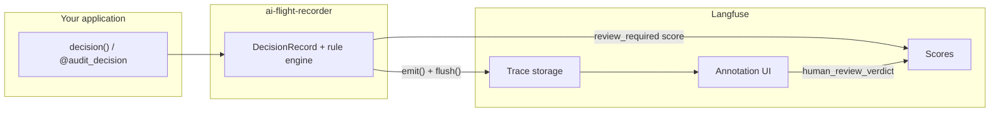
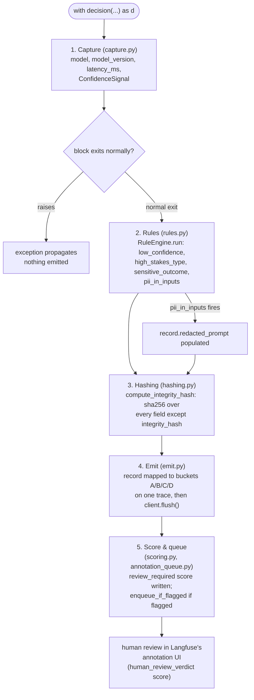
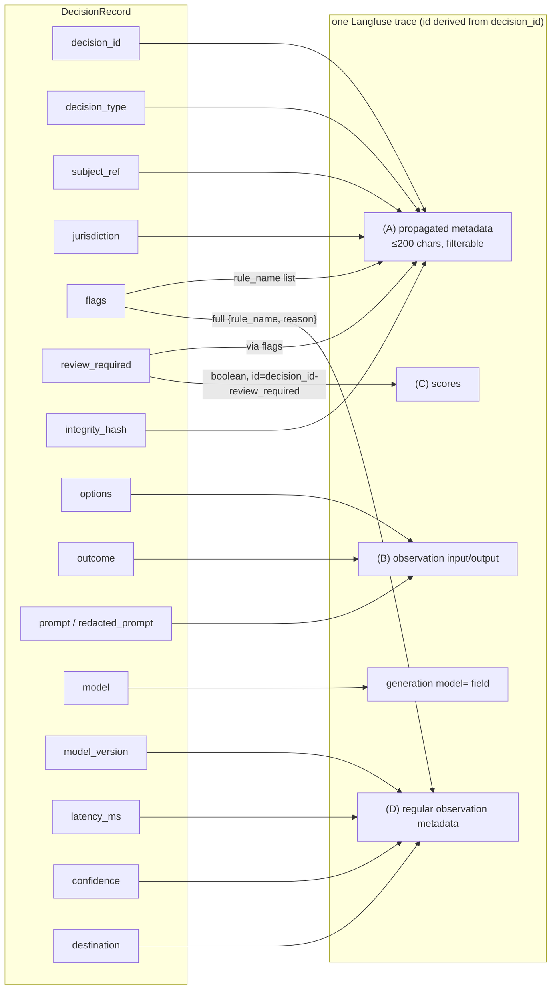

# Architecture

How ai-flight-recorder is put together: what each module is responsible for, how a decision
moves through the pipeline, and how the resulting record maps onto Langfuse's data
model.

## What this is

ai-flight-recorder is a thin governance layer on top of [Langfuse](https://langfuse.com). It
does not implement its own storage, viewer, or review UI. It builds a `DecisionRecord`
for one AI-influenced decision and maps it onto Langfuse's own data model: trace
metadata, observation input/output, and scores. Human review happens in Langfuse's
existing annotation UI.

| Concern | Who owns it |
|---|---|
| Tracing / storage | Langfuse |
| Human review UI (annotation) | Langfuse |
| Auth, multi-user access | Langfuse |
| Governance-shaped decision schema | ai-flight-recorder |
| Deciding *when* a decision needs review (rule engine) | ai-flight-recorder |
| Mapping the decision record onto Langfuse's data model | ai-flight-recorder |

For a non-Python client, use Langfuse's OTel endpoint or public API directly.
ai-flight-recorder doesn't ship multi-language clients.

**ai-flight-recorder records and surfaces decisions; it does not certify that any of them
were correct.** Confidence values are recorded for traceability, not as reliability
guarantees, and rule flags route human attention rather than render a quality verdict.

## Pipeline

A decision passes through five stages, in this order, all driven from `capture.py`.

### 1. Capture (`capture.py`)

`decision()` (a context manager) and `audit_decision()` (a decorator) both build a
`_DecisionContext`, which wraps a `Decision` handle around a `DecisionRecord`.

`Decision.completion()` / `Decision.acompletion()` wrap `litellm.completion` /
`litellm.acompletion` and auto-populate:

- `model`, `model_version`: read off the LiteLLM response
- `latency_ms`: wall-clock time around the call
- a `ConfidenceSignal`, from one of three sources:
  - `logprobs`: the geometric mean of per-token logprobs, computed automatically
    whenever the response includes them (pass `logprobs=True` to `completion()`)
  - `self_report`: opt-in (`confidence_method="self_report"`), sends one extra
    completion asking the model to rate its own confidence from 0 to 1. If that
    follow-up call itself fails (a provider rejecting one of its kwargs, a
    transient network error), the signal falls back to `none` rather than
    failing the decision being captured.
  - `none`: the default, when neither of the above applies

None of these are a claim that the decision was correct: `self_report` in particular is
well known to produce miscalibrated numbers, and is recorded for traceability, not as a
signal worth gating a decision on.

### 2. Rules (`rules.py`)

On normal exit from the `with` block, `RuleEngine.run()` walks the enabled
`BUILTIN_RULES` predicates against the finished record, appending `Flag`s and setting
`review_required`. If the block raises, the rule engine does not run and nothing is
emitted: an incomplete capture (for example, `outcome` not set) isn't a decision
worth recording, and the exception propagates unchanged.

Rules only route attention; they do not render a quality verdict on the decision itself,
since that judgment belongs to the human reviewer in Langfuse's annotation UI.

| Rule | Fires when | Config it reads |
|---|---|---|
| `low_confidence` | A confidence signal (`source` other than `none`) is below the threshold | `low_confidence_threshold` |
| `high_stakes_type` | `decision_type` is in the configured set | `high_stakes_types` |
| `sensitive_outcome` | `outcome` is in the configured set | `sensitive_outcomes` |
| `pii_in_inputs` | The prompt contains PII | `pii_detector`, `redact_pii_in_input` |

`pii_in_inputs` is the one rule with a side effect: when it fires, it populates
`record.redacted_prompt` via the configured `Detector` (see [PII
detection](#pii-detection) below), so the redacted text, not the raw prompt, is what
later stages see.

### 3. Hashing (`hashing.py`)

`compute_integrity_hash()` runs after the rule engine, so it covers any PII redaction
that just happened, and before anything is sent to Langfuse. It's a sha256 over every
`DecisionRecord` field except `integrity_hash` itself.

It proves the captured decision (what was asked, what was decided, under what
model/confidence/context) wasn't altered afterward. It does **not** cover the human
review verdict, because that verdict is not part of `DecisionRecord` at all: it's
recorded later, directly in Langfuse, as a score a reviewer sets through the annotation
UI. There's nothing to exclude from the hash beyond `integrity_hash` itself, because
nothing else is ever added to the record after this point.

`ai_flight_recorder.verify(record)` recomputes the hash and reports a mismatch rather than
raising, so a caller can decide how to react (flag it, log it, alert on it) instead of
the library dictating policy.

### 4. Emit (`emit.py`)

Maps the finished record onto Langfuse across four buckets:

| Bucket | What goes there | Size limit |
|---|---|---|
| (A) Propagated metadata | Short scalars, filterable in the Langfuse UI | 200 chars |
| (B) Observation input/output | Prompt/options as input, outcome as output | None |
| (C) Scores | `review_required`, written now as a boolean | None |
| (D) Regular observation metadata | Confidence, full flags, destination, model_version | None |

The split exists because Langfuse's propagated-attribute mechanism
(`propagate_attributes`) caps every value at 200 US-ASCII characters. It's built for
filterable dimensions, not payloads. ai-flight-recorder enforces that cap explicitly rather
than relying on Langfuse to silently drop oversized values: `_guard_scalar` truncates
with a visible `...[truncated]` marker and logs a warning. The untruncated value still
lives in bucket (D) or (B), so nothing is lost. It's just not filterable by the
truncated part.

All four writes land on one trace because the trace id is derived deterministically
from `decision_id` via `client.create_trace_id(seed=...)`. `emit()` does not flush;
`capture.py` calls `client.flush()` itself on normal exit (when `GovernanceConfig.auto_flush`
is `True`, the default), since batching a flush across multiple decisions is often
desirable when calling `emit()` directly.

Set `auto_flush=False` in a long-running service to skip that per-decision network
round trip and let the Langfuse SDK batch flushes on its own schedule instead. That's
safe there because the process keeps running long enough for the SDK's background
thread to send buffered events. `capture.py` still flushes immediately regardless of
`auto_flush` when a decision is about to be enqueued into a review queue (see
[Score and queue setup](#5-score-and-queue-setup-scoringpy-annotation_queuepy) below),
since the enqueue step needs the trace to already exist in Langfuse. `auto_flush=False`
is not safe for short-lived scripts or serverless invocations, where the process may
exit before that background thread gets a chance to run.

### 5. Score and queue setup (`scoring.py`, `annotation_queue.py`)

ai-flight-recorder only ever writes the `review_required` score; `human_review_verdict` is
set by a human reviewer directly in Langfuse's annotation UI, not by ai-flight-recorder.
`scoring.setup_score_configs()` creates both `ScoreConfig`s a project needs
before recording any decisions, idempotently (existing configs are returned as-is, not
duplicated).

`annotation_queue.enqueue_if_flagged()` is the step that gets a flagged decision in
front of a reviewer without them hunting through the trace table. It runs strictly
after `client.flush()`, since a queue item references a trace by id and Langfuse has
nothing to attach it to until that trace is actually persisted. Every Langfuse call in
this module is wrapped so a missing queue or a failing API call is logged and
swallowed, not raised: a broken review-queue integration must not take down decision
capture, since the trace itself was already written before the enqueue was attempted.

Only trace-level items (`objectType: "TRACE"`) are used; session-level items are
avoided because recent Langfuse SDK releases have a known response-validation bug for
that item type.

## The schema

`schema.py`'s `DecisionRecord` is the spec everything else maps onto. It has no
Langfuse awareness; it's plain pydantic. Every field lands in one of the four buckets
above:

| Field | Bucket | Notes |
|---|---|---|
| `decision_id` | A | Stable, unique id. Auto-generated (`uuid4().hex`) if not supplied. |
| `timestamp` | n/a | UTC, timezone-aware. Not sent to Langfuse directly; Langfuse timestamps the trace itself. |
| `decision_type` | A | e.g. `"loan_eligibility"`. Also the observation's `name` in Langfuse. |
| `subject_ref` | A | Opaque id for whom the decision concerns. A validator rejects values that look like an email, phone number, SSN, credit card, or IP address as a guardrail, not a guarantee, so pick a real opaque id. |
| `options` | B (input) | The choices under consideration. |
| `outcome` | B (output) | What was decided. |
| `model` / `model_version` | native generation field / D | `model` is passed to Langfuse's generation-native `model=` field, not metadata. `model_version` (e.g. `system_fingerprint`) goes in D. |
| `latency_ms` | D | Wall-clock time around the LiteLLM call. |
| `confidence` | D (full) | List of `{source, value, note}`. Not a reliability guarantee. |
| `jurisdiction` | A | Optional short scalar. |
| `destination` | D | Downstream system/consumer, if known. Kept in D rather than A since it may be richer than a short label. |
| `prompt` / `redacted_prompt` | B (input) | `redacted_prompt`, if the `pii_in_inputs` rule fired and redaction is enabled, is sent instead of the raw `prompt`. |
| `flags` | A (names only) + D (full) | A gets a comma-joined list of `rule_name`s for filtering; D gets the full `{rule_name, reason}` objects. |
| `review_required` | A (via flags) + C (score) | Set by the rule engine, written as a boolean score with a deterministic id `f"{decision_id}-review_required"`, so re-emitting the same decision updates the score instead of duplicating it. |
| `integrity_hash` | A | sha256 over every field above except `integrity_hash` itself. |

`subject_ref` is guarded via `RegexDetector`, imported directly rather than through
`GovernanceConfig`, so the schema module has no dependency on the config module.

## PII detection

`detectors/__init__.py` defines the `Detector` protocol (`detect(text) -> list[PIIMatch]`)
and the shared `redact_matches()` helper every implementation uses, so the rule engine
and redaction logic are detector-agnostic.

- **`RegexDetector`** (default, `detectors/regex.py`): zero extra dependencies. Covers
  email, phone, credit card (Luhn-checked), SSN/SIN, and IPv4, plus any
  `custom_patterns` supplied at construction. This is a pragmatic net, not an
  exhaustive PII scanner.
- **`PresidioDetector`** (`detectors/presidio.py`): higher recall, same `Detector`
  interface. Only available behind the `ai-flight-recorder[presidio]` extra: installing the
  base package does not pull in Presidio or its NLP models, and the module is only
  imported when a caller opts in by installing the extra and constructing it.

When PII is found, redaction replaces each match with `[REDACTED_<ENTITY_TYPE>]` and,
if `GovernanceConfig.redact_pii_in_input` is `True` (the default), that redacted text,
not the raw prompt, is what's sent to Langfuse as the observation input.

## Configuration

`config.py`'s `GovernanceConfig` is a plain dataclass, not pydantic, because it holds a
live `Detector` instance (a runtime dependency, not serializable data). It carries the
thresholds and toggles every stage above reads: `low_confidence_threshold`,
`high_stakes_types`, `sensitive_outcomes`, `enabled_rules`, `pii_detector`,
`redact_pii_in_input`, `review_queue_name`, `auto_enqueue`, and `auto_flush`. See the
[user guide](user-guide.md#configuration) for how to set each of these.

## Testing

`tests/conftest.py`'s `FakeLangfuseClient` implements the same subset of the Langfuse
v3 SDK interface that `emit.py` uses, recording every call so tests can assert on exact
A/B/C/D payloads. All tests are fully mocked (`FakeLangfuseClient`, and LiteLLM's
`mock_response`); nothing hits the network.

Note: `ai_flight_recorder/__init__.py` re-exports `emit` (the function), which shadows the
`emit` submodule attribute. Tests reach the module itself via
`importlib.import_module("ai_flight_recorder.emit")`, not `import ai_flight_recorder.emit`.

## Limitations

- ai-flight-recorder records and surfaces a decision but does not judge whether it was
  correct; flags route attention, not a quality verdict.
- Confidence values are not reliability guarantees. `logprobs`-derived confidence is a
  crude proxy (geometric mean token probability); `self_report` is well-documented to
  be unreliable. Both are recorded for traceability only.
- The developer must instrument decision points. ai-flight-recorder cannot discover where in
  your code an AI-influenced decision happens; you wrap it explicitly with
  `decision()` or `@audit_decision`.
- Depends on a running Langfuse instance. There's no local fallback storage; if
  Langfuse is unreachable, `emit`/`flush` calls will fail or queue depending on the
  SDK's own retry behavior.
- The integrity hash covers the captured decision, not the later human review. The
  human review verdict lives purely in Langfuse and was not part of the hashed
  schema.
- No multi-sample confidence/consistency scoring (asking the model multiple times and
  measuring agreement). Possible future work, not implemented.
- No multi-language clients. Langfuse's OTel endpoint and public API are the
  portability path if you need one.
